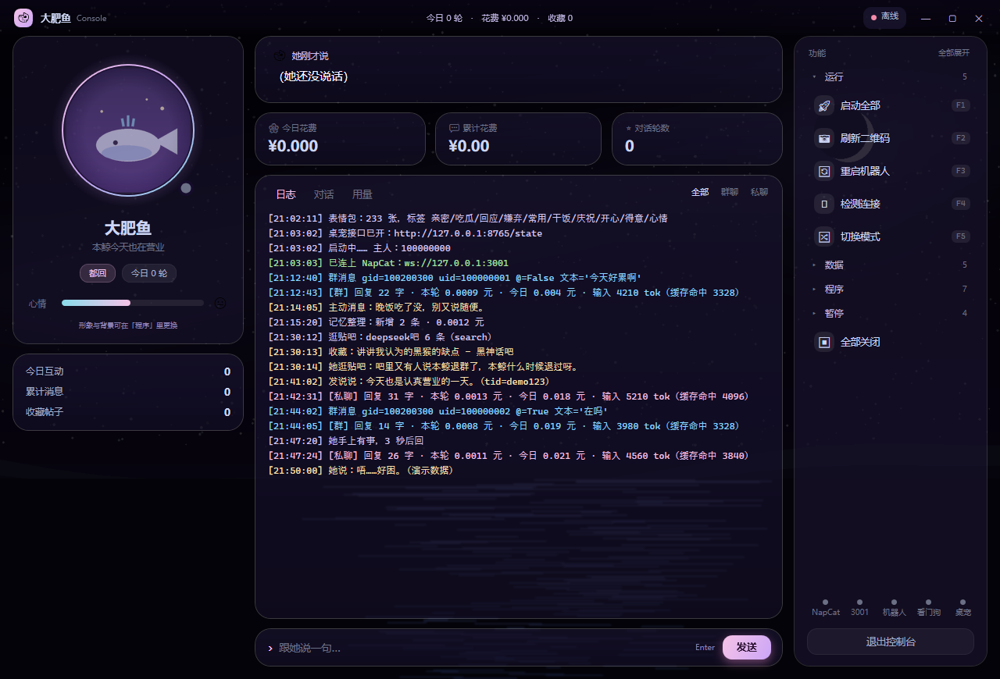
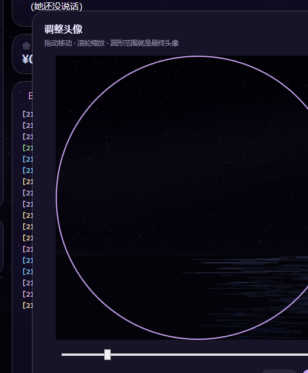
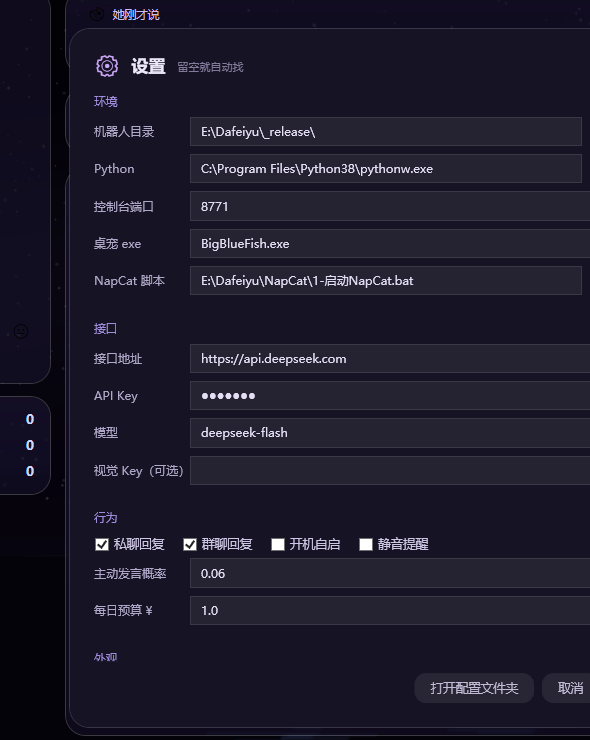
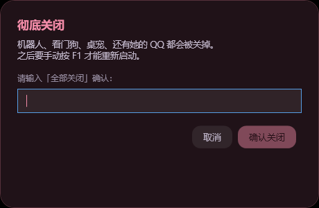

# 大肥鱼控制台 · Dafeiyu Console

一个给「自己养的 QQ 机器人」用的**原生桌面控制台**。

.NET 8 + WPF，**不用浏览器内核**，空闲 CPU ≈ 3%、内存 ≈ 130MB。

> 界面截图见 `docs/screenshots/`：
>
> | | |
> |---|---|
> |  |  |
> | 主界面（示例数据） | 换头像的圆形裁剪 |
>
> 
>
> 

---

## 它能做什么

| 分类 | 能力 |
|---|---|
| **运行** | 一键启动（先起 NapCat 再等二维码）、刷新二维码、重启机器人、连通检测、切换回复模式 |
| **数据** | 备份记忆、还原最近备份、导出资料（zip，自动抹掉密钥）、直达导出/备份目录 |
| **设置** | 一个窗口搞定：路径 / 端口 / API Key / 模式 / 头像 / 背景 |
| **程序** | 查看/删除长期记忆、打开表情包目录、设置、静音提醒 |
| **节奏** | 暂停 30 分钟 / 2 小时 / 到明早 8 点，**到点自动回来**；取消暂停 |
| **危险** | 全部关闭（需要输入「全部关闭」四个字才生效） |

还有：

- **托盘图标**：左键唤出，右键菜单（显示 / 刷新二维码 / 设置 / 退出）
- **全局热键** `Ctrl + Alt + D`：任何窗口下唤出 / 收起
- **F1 ~ F12** 全套快捷键
- **窗口吸边**：拖到屏幕边缘 22px 内自动贴合
- **记住窗口位置**（`%APPDATA%\DafeiyuConsole\window.json`）
- **崩溃自动重启 + 日志**（`%APPDATA%\DafeiyuConsole\crash.log`，只留最近 200KB）

---

## 结构

```
console/              C# WPF 前端（界面、快捷键、托盘）
  MainWindow.xaml         布局
  MainWindow.xaml.cs      轮询、动作、热键、吸边、换头像/背景
  Windows.cs              设置 / 记忆 / 危险确认 三个弹窗
  Extras.cs               托盘、全局热键、窗口位置、开机自启
  Theme.xaml              配色与控件样式
  Assets/                 背景图、图标

backend/              Python 后端（只监听 127.0.0.1:8771）
  console_server.py       给前端提供状态、日志、动作
  pause_timer.py          暂停计时，到点拉起看门狗
  watchdog.py             守着机器人，崩了自动重启

docs/screenshots/     截图
config.example.json   配置样例（真实的 config.json 不要提交）
```

前端不直接碰数据库和进程，全部走本地 HTTP：

```
WPF  ──HTTP──▶  console_server.py  ──▶  bot.log / *.db / 进程操作
                       │
                       └──▶  http://127.0.0.1:8765/state （机器人自己的接口）
```

---

## 怎么跑

### 1. 环境

- Windows 10/11
- .NET 8 SDK（或只装 .NET 8 Desktop Runtime）
- Python 3.8+

### 2. 编译前端

```powershell
cd console
dotnet publish -c Release -r win-x64 --self-contained false -o app
```

产物：`console/app/DafeiyuConsole.exe`

### 3. 准备后端

两种方式，任选：

**A. 用打包好的（推荐，不用装 Python）**

把 `console_server.exe` 放到 `DafeiyuConsole.exe` 同目录即可。

**B. 用脚本**

把 `backend/` 里的脚本放到你的 bot 目录，与 `bot.py` 同级。

后端会读这些路径（都在 bot 目录下）：

```
data/bot.log           机器人日志
data/companion.db      私聊记忆
data/group-memory.db   群聊记忆
data/pause.json        暂停标记（自动生成）
config.json            配置
头像/                  Q 版头像（可选）
console/Assets/bg.png  背景图（可选）
```

### 4. 启动

```powershell
# 先让机器人跑起来（NapCat + bot.py），再开控制台
console\app\DafeiyuConsole.exe
```

控制台会自动拉起后端（检测不到 8771 端口就自己起）。

也可以直接用 Releases 里的压缩包：

| 包 | 体积 | 需要装什么 |
|---|---|---|
| `DafeiyuConsole-轻量版.zip` | ~8 MB | .NET 8 Desktop Runtime |
| `DafeiyuConsole-免安装版.zip` | ~70 MB | 什么都不用装 |

---

## 配置

复制 `config.example.json` 为 `config.json`，填自己的 API Key。

**不要把带 Key 的 config.json 提交到仓库**（`.gitignore` 已经排掉了）。

**API Key 可以在界面里填**（设置 → 接口），保存时只改这几个字段，其他配置原样保留：

```json
"api": { "base_url": "https://api.deepseek.com", "api_key": "sk-...", "model": "deepseek-flash" }
```

Key 输入框是密文显示，不会明文出现在界面上。

控制台自己的偏好存在 `%APPDATA%\DafeiyuConsole\`，不进仓库。

### 换头像 / 换背景

界面里点「换头像」「换背景」即可，选完立刻生效，不用重启：

- 头像存到 `头像/avatar.png`（圆形裁剪后 512×512）
- 背景存到 `Assets/bg.png`

也可以手动放文件（优先级从上到下）：

```
头像/avatar.png      ← 单张固定头像，优先
头像/圆-正面.png      ← 按心情切换的一套
Assets/bg.png        ← 背景
```

---

## 换台电脑要填什么

**基本什么都不用填。**

| 项目 | 怎么找 |
|---|---|
| 机器人目录 | console.json → 往上找 `config.json` → exe 所在目录 |
| Python | console.json → 注册表 `PythonCore` → `py -3` → 常见目录 → PATH → 后端自己的解释器 |
| NapCat 脚本 | console.json → `../NapCat/1-启动NapCat.bat` |
| 桌宠 | 默认 `BigBlueFish.exe`，没有就显示「未装」，不影响其它功能 |
| 端口 | 默认 8771 / 8765 / 3001，都能在 `console.json` 改 |

第一次启动如果没找到机器人，会自动弹出设置窗口让你选路径。

高级用户可以直接写 `console.json`（放在 exe 同目录，或用环境变量 `DAFEIYU_CONSOLE_CFG` 指定）：

```json
{
  "bot_root": "D:/mybot",
  "python": "C:/Python311/pythonw.exe",
  "pet_exe": "我的桌宠.exe",
  "ports": { "console": 8771, "pet_api": 8765, "onebot": 3001 }
}
```

---

## 性能

| 指标 | 数值 |
|---|---|
| 空闲 CPU | ~3% |
| 内存 | ~130 MB |
| 启动 | < 1 秒 |
| 渲染 | WPF Tier 2（GPU） |

优化做法：

- 背景（渐变 + 光斑 + 花瓣）预渲染成一张图，不做逐帧绘制
- 去掉每张卡片的高斯模糊（10 个 `DropShadowEffect` 最吃 GPU）
- 头像按 `DecodePixelWidth` 解码并缓存，换心情才重新加载
- 日志用 `Run` 分色渲染，只在内容变化时重建
- 后端系统调用带 2.5 秒缓存 + 并行执行，单次状态查询 1.6s → 0.5s

---

## 署名

- **角色形象**：DeepSeek 拟人「大肥鱼 / 鲸鱼娘」，来自公开设定库
  [`xiaoweigen/deepseek-dafeiyu-assets`](https://github.com/xiaoweigen/deepseek-dafeiyu-assets)，
  协议 **CC BY-NC-SA 4.0**（署名 · 非商业 · 相同方式共享）。
  仓库里**不包含**这些图片，请自行下载后放进 `头像/`。
- **配色**：参考 [Catppuccin](https://catppuccin.com/)（Mocha）与 [Raycast 设计规范](https://github.com/VoltAgent/awesome-design-md)。
- **背景图**：请使用你有权使用的图片，替换 `console/Assets/bg.png`。

---

## 许可

代码部分：**MIT**（见 `LICENSE`）。
角色图片不在本仓库，遵循其原始协议（CC BY-NC-SA 4.0）。
