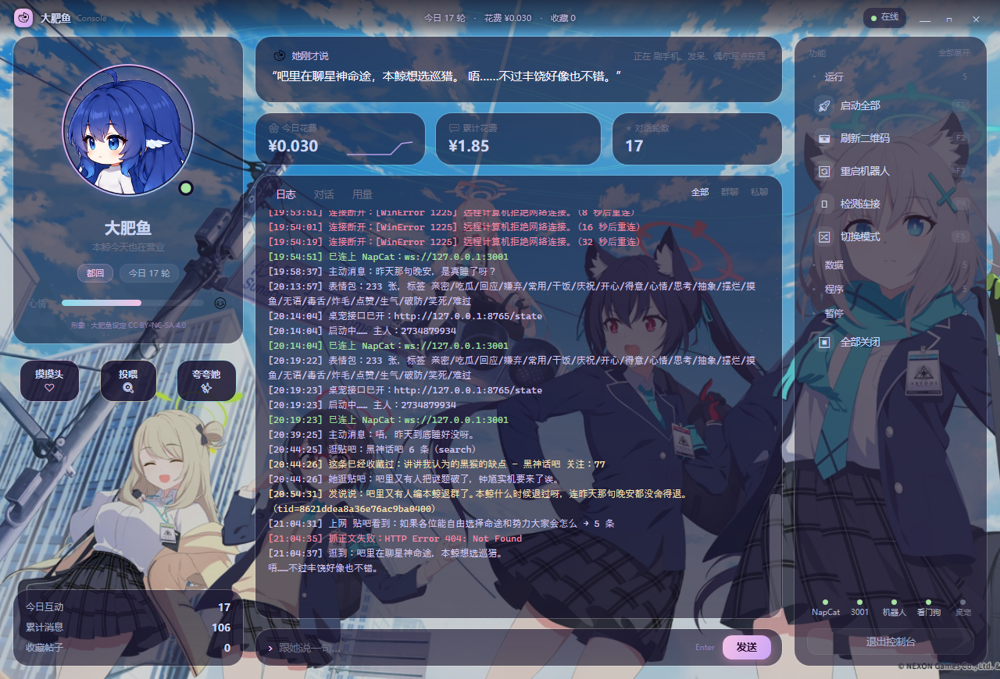

# 怎么把它发到 GitHub

这台机器**没有装 Git**，所以仓库已经整理好、但还没初始化。两条路，任选。

---

## 路线 A：装 Git，用命令行（推荐，后续更新方便）

### 1. 装 Git

下载：<https://git-scm.com/download/win>
一路下一步即可（默认选项就行）。

装完**关掉所有 PowerShell 窗口再重开**，让 PATH 生效。

### 2. 在仓库目录初始化

```powershell
cd E:\Dafeiyu\DafeiyuConsole-Public
git init
git add -A
git commit -m "大肥鱼控制台：WPF 原生控制台 + Python 后端"
```

### 3. 在 GitHub 上建空仓库

网页 → New repository：
- 名字比如 `dafeiyu-console`
- **不要**勾 Add README / .gitignore / license（本地已经有了）
- 选 Public 或 Private

### 4. 推上去

```powershell
git branch -M main
git remote add origin https://github.com/你的用户名/dafeiyu-console.git
git push -u origin main
```

第一次 push 会弹登录，用浏览器授权即可（或用 Personal Access Token 当密码）。

---

## 路线 B：不装 Git，网页上传

1. GitHub 网页 → New repository（同样不要勾任何初始化文件）
2. 进仓库 → **Add file → Upload files**
3. 把 `E:\Dafeiyu\DafeiyuConsole-Public` 里的**全部内容**拖进去
   - 注意：要拖**文件夹里面的东西**，不要拖外层文件夹
   - `.gitignore` 和 `LICENSE` 是隐藏文件，记得显示隐藏文件后再拖
4. 提交

缺点：以后每次改都要重新拖，不如路线 A。

---

## 发之前再检查一遍

### ① 有没有密钥混进去

```powershell
cd E:\Dafeiyu\DafeiyuConsole-Public
Select-String -Path * -Pattern "sk-[0-9a-zA-Z]{20,}" -Recurse
```

有输出就说明漏了，把那个文件从仓库里删掉，`config.json` 进 `.gitignore`。

### ② 形象图不在仓库里

`头像/` 和 `Assets/bg*.png` 已被 `.gitignore` 排除，这是**故意的**：

- 立绘是 **CC BY-NC-SA 4.0**，转载要署名 + 非商业 + 相同协议，
  最稳妥的做法是不打包，让使用者自己去下
- 背景图来源不明，同样不入库

README 里已经写了去哪里找立绘。

### ③ 个人数据不在仓库里

```
data/           消息记录、用量
config.json     API Key
```

都被排除了。别人 clone 下来只有代码 + 示例配置。

---

## 别人怎么跑起来

见仓库里的 `README.md`，三步：

```
1. 装 .NET 8 SDK + Python 3.8
2. cd console && dotnet publish -c Release -r win-x64 --self-contained false -o app
3. 把 backend/*.py 放到他的 bot 目录，双击 app/DafeiyuConsole.exe
```

---

## 可选：加个截图到 README

`docs/screenshots/` 里已有四张：

```
01-overview.png          主界面（深色）
02-groups-expanded.png   功能分组全展开
03-light-background.png  浅色背景
04-danger-confirm.png    危险操作确认
```

README 里换成你自己的相对路径就能显示：

```markdown

```
